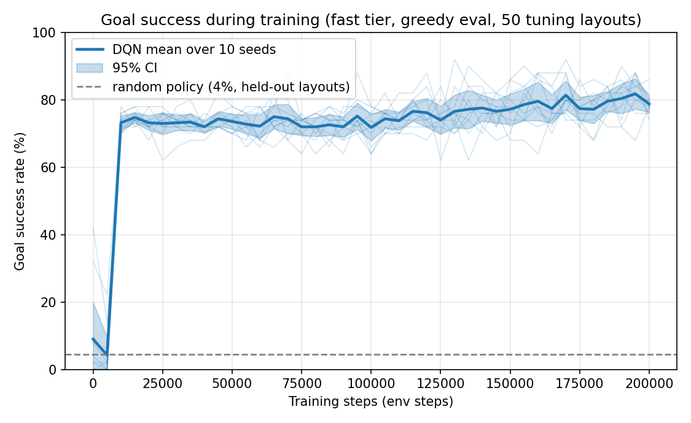

# TurtleBot3 DQN — Phase 1 (discrete actions)

A reproducible **vanilla DQN** experiment: a TurtleBot3 Burger learns to drive to random goals among
obstacles using 24 LiDAR bins + goal geometry and 5 discrete steering actions.
This is phase 1 of a discrete-vs-continuous action-space study; the env, logging and plotting are agent-agnostic so a
continuous agent (TD3) can be added in phase 2 without touching them (see [Extending to TD3](#extending-to-td3-phase-2)).

Two simulator tiers share one Gymnasium interface and one observation/reward implementation:

| tier | what | used for |
|---|---|---|
| **fast** (`envs/env_fast.py`) | pure-NumPy 2D diff-drive sim, emulated 360-sample LDS-01 LiDAR | full training (10 seeds × 200k steps, 10–20 min each) |
| **gz** (`envs/env_gz.py`) | ROS 2 Jazzy node around Gazebo Harmonic (`gz sim`) | short validation training + sim-to-sim transfer of the fast-trained policies |

## Results at a glance

Everything below was produced by the commands in this README (`./run_final.sh`); raw CSVs are in `results/`, plots in
`results/*.png`. Success/collision/timeout are **greedy (ε=0) evaluations of the last checkpoint on 200 held-out layouts**
that were never used for any decision (§5.1); ± is the 95 % CI over seeds.

| Condition | Seeds | Success % | Collision % | Timeout % | Mean return |
|---|---|---|---|---|---|
| Fast-trained (200k steps), fast eval | 10 | 73.7 ± 2.4 | 26.4 ± 2.4 | 0.0 | 111.7 |
| Fast-trained, Gazebo eval (transfer) | 10 | 72.0 ± 2.4 | 27.9 ± 2.4 | 0.05 | 107.6 |
| Gazebo-trained (30k steps), Gazebo eval | 3 | 60.2 ± 13.0 | 39.8 ± 13.0 | 0.0 | 76.6 |
| Heading-only oracle (ignores the LiDAR), fast | - | 68.0 | 32.0 | 0.0 | 96.9 |
| Random policy, fast / Gazebo | - | 4.5 / 3.5 | 95.5 / 96.5 | 0.0 | -106.7 / -107.7 |

* **Transfer gap: 1.6 ± 1.6 points** (paired over 10 seeds), down from 23 points in the previous version. The old gap came
  from two Gazebo-tier defects (wheel traction lost after hard turns with DART's default collision detector, and wheel
  odometry used as the pose), not from the policy (§4, §6, `results/transfer_diag/report.md`).
* DQN beats a controller that ignores the obstacles by ~6 points: real but modest.
* Training is stable (no collapse in 10 seeds, no Q divergence) and bit-for-bit reproducible, including across resumes after
  WSL restarts (§6).



Details, caveats and the analysis are in [Results & analysis](#6-results--analysis).

---

## 1. Install (WSL2 + Ubuntu 24.04 + ROS 2 Jazzy + Gazebo Harmonic)

Target: Windows 11, WSL2, Ubuntu 24.04. The project must live on the Linux filesystem (`~/tb3_dqn`), **not** `/mnt/c`
(`setup.sh` refuses otherwise).

```bash
cd ~/tb3_dqn
bash setup.sh                 # idempotent; add --skip-apt (no sudo) and/or --no-bashrc if you prefer
source venv/bin/activate
```

`setup.sh` does, skipping whatever is already satisfied:

1. adds the ROS 2 apt source and installs `ros-jazzy-desktop ros-jazzy-ros-gz ros-jazzy-turtlebot3 ros-jazzy-turtlebot3-msgs`
   (+ colcon, rosdep, venv tooling);
2. clones `ROBOTIS-GIT/turtlebot3_simulations` **branch `jazzy`** into a colcon workspace (default `~/turtlebot3_ws`,
   override with `TB3_WS=`) and builds it from source;
3. creates `venv/` with `--system-site-packages` (so `rclpy` imports) and pip-installs PyTorch (CPU wheel index),
   numpy, pandas, matplotlib, pyyaml, gymnasium — *only if they are not already importable*;
4. appends an environment block to `~/.bashrc` (`TURTLEBOT3_MODEL=burger`, `GZ_SIM_RESOURCE_PATH`, `ROS_DOMAIN_ID`,
   workspace overlay);
5. verifies the install.

**Verified before relying on it** (Oct 2026): all four apt packages have installation candidates on noble/jazzy, and the
`jazzy` branch exists upstream. apt also ships binary `ros-jazzy-turtlebot3-gazebo`/`-simulations`; the brief asks for a
source build, so that is what `setup.sh` does (the generator in `envs/gz_world.py` reads the Burger SDF from the built package).

> **What was and was not exercised.** I developed this on a machine that already had ROS/Gazebo/the workspace, and ran
> `setup.sh --skip-apt --no-bashrc` there (workspace detection, venv creation, verification all pass). The apt-repo bootstrap,
> `rosdep`, the fresh `colcon build` and the `~/.bashrc` block were **not** exercised end-to-end on a clean machine.
> Note the venv inherits the system `torch` here, so the CPU-wheel pip step was skipped.

To check that TurtleBot3 teleop works in Gazebo (build-order step 1) with the stock package:

```bash
ros2 launch turtlebot3_gazebo empty_world.launch.py     # GUI through WSLg
ros2 run turtlebot3_teleop teleop_keyboard              # Jazzy publishes TwistStamped on /cmd_vel
```

## 2. Running

All commands run from `src/` with the venv active.

```bash
# --- fast tier -----------------------------------------------------------------------------
python train.py --agent dqn --env fast --seed 0 --smoke        # ~2k steps, seconds
python train.py --agent dqn --env fast --seed 0                # 200k steps, ~10 min
for s in 0 1 2; do python train.py --agent dqn --env fast --seed $s & done; wait   # 3 seeds in parallel (1 thread each)

# --- Gazebo tier (needs the sim running) ---------------------------------------------------
./start_gz.sh                                                  # terminal 1: headless gz sim + ros_gz bridge
python train.py --agent dqn --env gz --seed 0 --smoke          # terminal 2: also checks /scan /odom /cmd_vel, dt
python train.py --agent dqn --env gz --seed 0                  # 30k steps, ~2.5 h incl. evals (real time)

# --- transfer, baselines, plots ------------------------------------------------------------
python evaluate.py --checkpoint ../results/runs/fast_dqn_seed0/final.pt --env gz
python evaluate.py --random --env fast                         # random-policy baseline (also --env gz)
python evaluate.py --checkpoint <ckpt> --env fast --layouts report   # held-out report layouts (final numbers only)
python validate_gz.py                                          # sim-to-sim sanity checks (see §4)
python plot.py                                                 # regenerates every plot from the CSVs
python plot.py --env gz                                        # plots for the Gazebo validation runs

# --- the final protocol behind the headline numbers (§6) -----------------------------------
./run_final.sh train          # 10 seeds x 200k, fast tier
./run_final.sh report-fast    # every final.pt + random policy on the 200 held-out report layouts
./run_final.sh report-gz      # the same in Gazebo (starts its own isolated sims), incl. the Gazebo-trained runs
./run_final.sh plots

# --- transfer-gap diagnosis (§6, results/transfer_diag/report.md) ---------------------------
python evaluate.py --checkpoint <ckpt> --env gz --record-steps --out-dir ../results/transfer_diag/gz_gt
python diagnose_transfer.py analyse --b gz_gt    # outcome table, divergence, Q-margins, collision geometry, plots
python diagnose_transfer.py drift --set gz_gt    # pose the LiDAR actually sees (scan matching) vs the env pose
python diagnose_transfer.py replay --src fast --env gz      # open-loop counterfactual
python diag_dynamics.py --env gz                 # command delay / step response of a tier
```

* Every run prints a summary table at the end (`env tier | success % | collision % | timeout % | mean return`).
* Re-running a `train.py` command **resumes** from `ckpt_latest.pt` (written after every evaluation, includes the replay
  buffer); use `--fresh` to restart. After a WSL restart just run the same command again.
* `--set section.key=value` overrides any config value for a run (used for tuning); `--tag name` sends the run to `results/tuning/`.
* **Layout sets.** Periodic evaluations and every selection decision use the 50 *tuning* layouts (`eval.tuning_layout_seed`);
  the headline numbers use 200 held-out *report* layouts (`eval.report_layout_seed`, `evaluate.py --layouts report`) that
  were never used for a decision.
* **Gazebo variants.** `GZ_WORLD_ARGS="--set gz.generated_dir=../gz_generated_x --set key=val" ./start_gz.sh` generates a
  world from config overrides into its own directory (used for the stock-physics before/after runs in §6).
* **Parallel Gazebo runs.** One sim cannot be shared between runs. For N concurrent runs start N isolated sims:
  `GZ_PARTITION=tb3_s$i ROS_DOMAIN_ID=$((50+i)) ./start_gz.sh` and use the same two variables for that run's `train.py`.
  That is how the three Gazebo seeds here were run (each sim held a real-time factor of 1.00).

### Outputs

```
results/runs/<env>_dqn_seed<N>/   train_episodes.csv  eval.csv  final.pt  final_eval_episodes.csv  final_eval_traj.npz
                                  ckpt_latest.pt(+.replay.npz) state.json config_snapshot.json env_info.json
results/report/                   held-out report-layout evaluations (headline numbers) + per-episode CSVs
results/transfer/                 evaluate.py's default output directory (earlier stock-physics runs: results/archive/)
results/transfer_diag/            transfer-gap diagnosis: recordings, report.md, plots
results/repro/                    reproducibility runs (§6)
results/tuning/                   every hyper-parameter / fidelity tuning run (same format)
results/archive/                  superseded results kept for before/after comparisons
results/*.png, summary*.csv, stability*.csv   plots / summaries written by plot.py
```

`eval.csv` has, per evaluation (every 5k steps, 50 episodes, ε=0): success / collision / timeout rate, mean return,
mean steps-to-goal (successful episodes only), mean |Δw| (path smoothness), plus mean training-episode return since the
previous evaluation, ε, and the cumulative training-episode count. For stability analysis it also logs the interval mean
and max of the TD loss, Q(s,a), max_a Q(s,a), TD target and pre-clip gradient norm (`upd_*`), and an overestimation probe:
max_a Q(s₀,a) at the start of each eval episode vs the realised discounted greedy return (`q0_mean`, `disc_return_mean`).
These are logged only; nothing feeds back into learning.

## 3. Design choices

**Task.** Square 4 m arena, 3–6 obstacles (cylinders r=0.15 m and 0.30 m boxes), random start pose and goal
(1–3 m apart). Episode ends on goal (<0.2 m), collision (min LiDAR bin <0.13 m) or 500 steps. Control rate 10 Hz in both tiers.
**Observation** (28-d): 24 LiDAR bins (min over a 15° sector of the 360-sample scan, `range/3.5`), distance to goal
(`/5.66`), heading to goal wrapped to [−π, π], last v and last w (normalised). **Actions** (5): v = 0.15 m/s constant,
w ∈ {+1.5, +0.75, 0, −0.75, −1.5} rad/s (hard-left … hard-right), all within the Burger limits (0–0.22 m/s, ±2.84 rad/s).
**Reward:** +100 goal, −100 collision, `50 × (previous − current goal distance)` progress shaping, −0.05 per step.
Everything is in `src/config.yaml`.

* *Progress shaping is potential-based* (difference of distance-to-goal), so circling or wall-hugging nets zero shaping and
  just pays the step penalty — this is the guard against the "reward hacking" pitfall. Collision takes priority over goal if
  both trigger on one step.
* *Shared logic.* Action decoding, observation, reward, termination and the heading wrap live once in `envs/common.py`;
  each tier only implements "reset the world" and "advance one control period". Both tiers also run the **same
  `ScanBinner`** (360 raw samples → 24 min-pooled bins), and the fast tier emulates the LDS-01 (360 samples, 0.12–3.5 m,
  σ=1 cm noise, 3.2 cm lidar offset, 1 m/s² linear-accel limit as in the Burger's DiffDrive plugin).
* *Fixed evaluation layouts.* `eval.layout_seed` generates 50 layouts once; evaluation episode *i* uses layout *i*, in both tiers.

**DQN (`agents/dqn.py`)** — vanilla only. `y = r + γ·max_a' Q_target(s',a')·(1−done)`: the target net both selects and
evaluates (no Double/Dueling/PER/n-step). MLP 2×256 ReLU, Adam lr 5e-4, γ 0.99, batch 128, replay 100k, hard target copy every
1,000 steps, Huber loss, gradient-norm clip 10, ε linear 1.0→0.05 over 100k steps (15k in the Gazebo tier), 5k warm-up random steps
(1k in Gazebo). One gradient step per env step.

* `done` is **only** goal/collision. A 500-step *truncation* is not a terminal state (the observation has no clock), so it still
  bootstraps. `agent.observe(..., terminated, truncated)` receives both.
* The agent interface is `act / observe / update / save / load (+ info)` (`agents/base.py`); `train.py`, `evaluate.py` and
  `plot.py` only use that interface.

**Reproducibility.** Python, NumPy, torch and both envs are seeded from `--seed`; env seeding goes through `env.reset(seed=…)`.
Each checkpoint also stores the training- and eval-env RNG states, so on the fast tier a resumed run is **bit-identical** to an
uninterrupted one (verified, §6). Training is CPU-only and single-threaded per process. Every run writes `env_info.json`
(Python/torch/NumPy/gymnasium/pandas versions, platform, a hash of the resolved config and a hash of every source file),
because the project is not under version control.

### The Gazebo tier

* **`/cmd_vel` message type.** The Jazzy TurtleBot3 bridge config
  (`turtlebot3_gazebo/params/turtlebot3_burger_bridge.yaml`) maps **`geometry_msgs/msg/TwistStamped`** ↔ `gz.msgs.Twist` (its
  own comment says "if you use Twist, you need to change the type"). `env_gz` therefore publishes `TwistStamped`;
  `gz.cmd_vel_type: Twist` switches both the publisher and the generated bridge. `--smoke` verifies that `/scan`, `/odom`
  publishers and a `/cmd_vel` subscriber exist, that messages actually arrive, and that the measured control period equals
  `1/rate`.
* **Generated assets.** `envs/gz_world.py` writes `gz_generated/{world.sdf,bridge.yaml,models/tb3_burger_rl}` from `config.yaml`
  (arena size, obstacle pool, goal marker, physics profile, cmd_vel type) and patches the stock Burger SDF so the LiDAR publishes
  at the control rate (stock: 5 Hz; at 10 Hz control that would give every other step a duplicate scan — the "mismatched control
  rates" pitfall).
* **Pose source.** The env's pose (goal distance/heading in the observation, and the goal test) comes from `gz.pose_topic`:
  by default `/odom_gt`, the physics pose published by gz's `OdometryPublisher` (added to the generated model and bridged
  like `/odom`). This matches the fast tier, which has always used the true pose. `/odom` (wheel odometry) is still bridged
  and selectable, but it drifts badly (§4).
* **Physics.** The generated world sets DART's collision detector to `bullet` (`gz.dart_collision_detector`) and gives the
  Burger's empty `base_footprint` link a negligible inertial (`gz.fix_base_footprint_inertia`); see §4.
* **Timing.** One env step = the first `/scan` whose *simulation* stamp is ≥ previous + dt. The pose is matched to the scan stamp.
  Gazebo runs in real time, so ≈ 7–10 env steps/s.
* **Goal marker.** A visual-only green disc (no collision, so LiDAR and robot ignore it); it is visible if you start the GUI
  with `./start_gz.sh --gui`.
* **Reset without teleporting the robot** — see the next section; this was the most important Gazebo finding.
* `gz.lockstep: true` pauses the sim and advances exactly one control period per step (`WorldControl.multi_step`). It works,
  but it was **not faster** here (4–7 steps/s vs 7–10), so the per-step cost is dominated by simulating/rendering the sensors, not by the real-time cap (I did not profile which part).
  It is kept as an option for determinism; the runs reported here use the default free-running mode.

## 4. Gazebo fidelity: what I checked, and four bugs it found

`python validate_gz.py` (needs `./start_gz.sh`) runs sim-to-sim checks; latest result (final Gazebo configuration):

| Check | Result |
|---|---|
| [1] Reset leaves the robot in collision | 0 / 50 layouts |
| [2] LiDAR, gz vs fast at reset (50 layouts x 24 bins) | mean abs diff 0.015 m, p95 0.029 m (max 1.85 m: one bin on an obstacle edge) |
| [3] gz LiDAR vs the fast-tier scan rendered at the env's pose, scripted drive | mean 0.010 m (with wheel-odometry pose: 0.048 m) |
| [4] Same action sequence, gz vs fast | position divergence mean 0.025 m, final 0.042 m, final yaw diff 0.06 rad |
| [5] Heading-only oracle, outcome agreement | 9 / 10 layouts |
| [6] Uncommanded yaw after a hard turn (ground truth vs wheel odometry, 20 straight steps) | ≤ 0.18 rad (stock physics: up to 2.3 rad) |

Four real problems were found *only* by checking ground truth against what the controller believes. Each would have
silently distorted the transfer experiment; the last two were found by the transfer-gap diagnosis (§6,
`results/transfer_diag/report.md`) and invalidated the Gazebo numbers reported before it (archived in
`results/archive/gz_stock_physics/`).

1. **Ground friction.** My first generated world used a bare ground plane (default μ = 1). With it the Burger slipped during
   hard turns: yaw rate reached only roughly 40–65 % of the commanded rate while `/odom` (wheel-integrated) reported the full rate.
   The official worlds use the Fuel "Ground Plane" (μ = 100, μ₂ = 50); copying that, and the official physics profile, fixed it.
2. **`set_pose` teleport.** Teleporting the Burger with `set_pose` appeared to corrupt its dynamics (yaw lagging the wheels,
   then spinning on for ~1 s after the command went to zero). Each reset therefore (a) does a gz **world reset**, which puts
   the robot at the world origin with fresh joints and odometry, and (b) moves the walls, obstacles and goal by the rigid
   transform `inv(start)` so the robot sits at the layout's start pose *in the arena frame*. Respawning the model
   (`remove`+`create`) was flaky (the new LiDAR sometimes never published). *In hindsight* the spinning was most likely bug 3
   below, which also happens without any teleport; the world-reset procedure is kept because it is correct either way.
3. **Wheel contact in DART's default collision detector.** With the default (FCL) detector, and also with ODE, the Burger
   loses wheel traction after a hard turn held for a few steps: the wheels go straight (as commanded, per `joint_states`)
   while the body keeps yawing at ~1.4 rad/s for 1–2 s and then re-grips abruptly. Measured against the gz physics pose:
   up to 2.3 rad of uncommanded yaw in 20 steps. Setting `<dart><collision_detector>bullet</collision_detector></dart>`
   reduces it to ≤ 0.18 rad (check [6]). On the way I also found that the stock Burger SDF declares
   `<link name="base_footprint"/>` without an inertial, so SDF's default (1 kg, I = 1 kg m²) is merged into the chassis (its
   own Izz is 0.0195); fixing it alone did not stop the spin-out (worst 2.29 vs 2.22 rad) but is kept as a correction.
4. **Wheel odometry as the pose.** The env originally used `/odom` for the goal geometry and the success test. Because of
   bug 3, odometry yaw was off by 1–2 rad in many episodes (still a median 0.41 rad per episode with bullet). Scan matching
   the recorded LiDAR against the known layout showed that only 7 % of the stock-physics Gazebo "goals" were real (within
   0.2 m). The env now uses the ground-truth pose (`/odom_gt`).

Remaining known differences: a **47–56 ms effective command delay** in free-running Gazebo (16 ms in lockstep; 0 in the fast
tier), measured with `diag_dynamics.py`. It changes small details of the paths but not the outcomes (§5, §6). The
heading-only oracle still disagrees on 1 of 10 layouts (a corner graze).

## 5. Hyperparameter tuning (documented as required)

The first full run used `progress_weight = 10`. It learned, but unstably: success rose quickly, **collapsed** in the middle of
training (the 3-seed mean dipped to about 3 %, below the 6 % random baseline, around 75–90k steps) and only recovered late — final success
60 / 46 / 72 % over 3 seeds (last-4-eval means 80 / 51 / 62 %, mean 64 %). I then ran short controlled sweeps
(100k steps, ε-decay 50k, 3 seeds unless noted; the metric is mean eval success over the last four evaluations):

| change vs. control | seeds | success % (mean) | range |
|---|---|---|---|
| control: progress_weight 10, Huber, lr 5e-4 | 3 | 11 | 6–19 |
| reward_scale 0.01 (targets O(1); hypothesis: Huber treats ±100 as outliers) | 2 | 22 | 18–25 |
| reward_scale 0.01 + lidar_clip 1.5 m | 2 | 6 | 1–12 |
| reward_scale 0.01 + lr 1e-4 | 2 | 5 | 4–5 |
| lr 1e-3 | 3 | 3 | 1–6 |
| MSE loss + reward_scale 0.01 | 3 | 3 | 0–5 |
| progress_weight 20 | 3 | 43 | 40–50 |
| progress_weight 20 + lr 1e-3 | 3 | 15 | 14–18 |
| progress_weight 20 + MSE + reward_scale 0.01 | 3 | 4 | 1–6 |
| progress_weight 30 | 3 | 64 | 54–70 |
| **progress_weight 50 (chosen)** | 3 | **76** | 73–84 |
| progress_weight 100 | 3 | 73 | 70–76 |

* My first hypothesis (reward scale / Huber outliers) was **not** supported; neither were a smaller LiDAR range, lower or higher lr,
  or MSE. What helped was **stronger shaping**: success rose monotonically with `progress_weight` up to ≈ 50 and was flat at 100.
  I did not investigate *why* beyond this; a plausible reading is that, with γ = 0.99 and a −100 collision at the end of
  ~100-step episodes, the goal-progress signal was too weak relative to the discounted collision penalty, but I did not test it.
* The shaping stays potential-based, so a larger weight changes the scale of the task reward but not which policies are optimal.
  It does mean **absolute return numbers are not comparable across `progress_weight` values** (the untuned run's returns are not
  on the same scale as the final ones).
* **Caveat — tuning on the evaluation layouts.** The sweep scored candidates on the same 50 fixed layouts that the first
  version of this README also reported on. With 3 seeds and 50 episodes per point the ranking of the top rows is
  not reliable at the few-percent level, and numbers reported on those layouts are mildly optimistic by selection (about
  6 points, judging by the earlier held-out check). I did not tune anything else
  (network size, batch, buffer, γ and target-update interval were fixed by the brief).
* The sweep logs are in `results/tuning/`; the untuned 200k run is `results/tuning/untuned_pw10_200k_seed*`.
  Because of the caveat above, the 50 sweep layouts are now formally the *tuning* set and the headline numbers come from a
  separate held-out set (below).

### 5.1 Evaluation protocol (no tuning on reporting layouts)

* `eval.tuning_layout_seed: 12345` (50 layouts): the periodic evaluations during training and **every** selection decision —
  the `progress_weight` sweep above and all environment-fidelity choices below. These are the layouts the sweep already
  used, so no new layouts were spent on tuning.
* `eval.report_layout_seed: 987654` (200 layouts, 200 episodes): **only** the final checkpoints of the final
  configuration, in both tiers. Nothing was chosen by looking at these numbers. (They were evaluated once before, for the
  held-out check in the previous version of this README; no decision followed from it.)
* The headline uses the **last** checkpoint of each run (`final.pt`), never a best checkpoint picked on any layout set.

### 5.2 Environment-fidelity changes (transfer-gap work, `results/transfer_diag/report.md`)

These change the simulators, not the algorithm or the reward. Candidates were tried one at a time and judged on the tuning
layouts, by Gazebo transfer success of fast-trained policies (3 checkpoints x 50 episodes). The bar for keeping one was a
clear gain (≥ 10 points, beyond the noise of 150 episodes) without costing more than a few points in the fast tier.

| change (config key) | fast-tier success | Gazebo transfer success | kept? |
|---|---|---|---|
| baseline: stock Gazebo physics, wheel-odometry pose | 82.0 % | 57.3 % (and only 7 % of its goals real) | - |
| Gazebo pose = ground truth (`gz.pose_topic: /odom_gt`) | unchanged | 74.0 % | **yes** (measurement fix, §4 bug 4) |
| + DART collision detector bullet (`gz.dart_collision_detector`), base_footprint inertial (`gz.fix_base_footprint_inertia`) | unchanged | **80.0 %** | **yes** (physics fix, §4 bug 3) |
| + fast tier: 50 ms command delay (`run.act_delay_s: 0.05`), 3 seeds retrained | 81.3 % (83.8 % with the delay) | 83.3 % (82/74/94) | no: +3.3 points is within noise |
| fast tier: actuation lag (`run.act_lag_tau_s`) | - | - | not tried: Gazebo shows a pure delay, not a lag (fit gain on w_{k-2} ≈ 0.01) |
| collision / LiDAR geometry alignment | - | - | not needed: no mismatch found (§6) |
| domain randomisation (`run.act_delay_jitter_s`, noise) | - | - | not needed: the policy is not brittle to small observation differences (§6) |

The two Gazebo fixes are bug fixes rather than tuning: they make Gazebo agree with ground truth. The fast-tier options
(`act_delay_s`, `act_delay_jitter_s`, `act_lag_tau_s`) stay in the code, default 0 (the default code path is bit-identical
to before), for phase 2 and the real robot, where latency will be larger.

## 6. Results & analysis

### Summary (vanilla DQN, ε = 0, final checkpoints, 200 held-out report layouts)

Protocol (§5.1): every decision was made on the 50 tuning layouts; the numbers below come from 200 **report** layouts
(`eval.report_layout_seed` 987654) that no decision looked at, one episode per layout, using the **last** checkpoint of
each run. ± is the 95 % CI of the mean over seeds (Student t). Gazebo = the final Gazebo tier (bullet physics,
ground-truth pose; §4).

| Condition | Seeds | Success % | Collision % | Timeout % | Mean return |
|---|---|---|---|---|---|
| Fast-trained (200k), fast eval | 10 | **73.7 ± 2.4** | 26.4 ± 2.4 | 0.0 | 111.7 ± 6.2 |
| Fast-trained (200k), Gazebo eval (transfer) | 10 | **72.0 ± 2.4** | 27.9 ± 2.4 | 0.05 | 107.6 ± 6.2 |
| Gazebo-trained (30k), Gazebo eval | 3 | 60.2 ± 13.0 | 39.8 ± 13.0 | 0.0 | 76.6 ± 34.6 |
| Heading-only oracle (ignores LiDAR), fast | - | 68.0 | 32.0 | 0.0 | 96.9 |
| Random policy, fast / Gazebo | - | 4.5 / 3.5 | 95.5 / 96.5 | 0.0 | -106.7 / -107.7 |

Per-seed success (fast / Gazebo): seed 0 75.0 / 73.0, 1 74.5 / 74.0, 2 80.5 / 75.5, 3 68.5 / 68.5, 4 71.5 / 71.5, 5 69.5 / 66.5, 6 74.5 / 69.0, 7 76.0 / 77.0, 8 74.0 / 74.5, 9 72.5 / 71.0; Gazebo-trained 55.0 / 65.5 / 60.0.
Files: `results/report/summary.csv` (+ per-episode CSVs), `results/summary.csv`, `results/summary_gz.csv`,
`results/stability.csv`. Plots: `results/*.png` (fast tier, learning curves on the tuning layouts; the bar chart uses the
report layouts) and `results/*_gz.png`.

On the tuning layouts the same final checkpoints score 78.8 % (last periodic eval, mean of 10), i.e. about 5 points more
than on the held-out set, consistent with the earlier estimate that numbers on the tuning layouts are optimistic.

### What changed since the previous version of this section

The previous version reported 82.7 % (fast, 3 seeds, tuning layouts), 59.3 % (fast → Gazebo) and 54.0 % (Gazebo-trained).
The fast number came from the tuning layouts; the two Gazebo numbers were produced by a Gazebo tier with two defects found
by the transfer-gap diagnosis below, and **overstated real goal reaching** (only 7 % of those Gazebo "goals" put the robot
within 0.2 m of the goal). They are superseded; the old files are in `results/archive/`.

### Learning speed

All 10 seeds pass 70 % success on the tuning layouts at the first evaluation after the 5k-step random warm-up (10k steps),
much earlier than the 50–100k the brief allowed for (random policy ≈ 5 %). After that the curve is essentially a plateau
(mean 72–75 % from 10k to 100k) that creeps up to 79 % by 200k as ε reaches its floor. Training takes ~1,940 episodes per
200k steps and ~12–20 min per seed on one CPU thread. In Gazebo (30k steps, ε decays over 15k) success reaches
48–72 % by 10–15k steps and 64 / 76 / 68 % at 30k on the tuning layouts (mean 69 %, vs ~73 % for the fast tier at the same 30k steps); on the held-out layouts the Gazebo-trained checkpoints score 60.2 % (55.0 / 65.5 / 60.0), i.e. 30k Gazebo steps buy clearly less than 200k fast-tier steps transferred (72.0 %). With 3 seeds the CI is wide (±13 points); Gazebo runs near real time, so its budget is 7× smaller than the fast tier's.

### Final success and collisions

Failures are collisions, not timeouts (0 % timeouts everywhere), so the agent keeps driving toward the goal and fails by
clipping obstacles or walls; there is no sign of reward hacking (circling or wall-hugging would show up as timeouts).
Successful episodes take 115 ± 2 steps. **A heading-only controller that ignores the LiDAR reaches 68.0 % on the same
held-out layouts**, so DQN is 5.7 points (≈ 18 % fewer collisions) better than not avoiding obstacles at all. That is a real
but modest margin, and the paper should say so; it is also the obvious headroom for phase 2.

### Transfer gap: diagnosis and fix

Full report: `results/transfer_diag/report.md` (all tables, plots and commands). Short version:

* The fast-trained policies are **not** brittle: rerunning them in the fast tier with a different LiDAR-noise seed flips the
  outcome on only 3 % of layouts, although their Q-margins are tiny (median 0.02) and the argmax flips often.
* In the original Gazebo tier, 41 % of outcomes flipped and the robot's believed pose was wrong: rendering the scan at the
  pose the env used differed from the real Gazebo scan by 0.56 m (control 0.009 m), and at the gap collisions that pose put
  the robot 0.51 m from the nearest obstacle while the LiDAR read 0.125 m. Scan matching showed wheel-odometry yaw errors
  of 1–2 rad, appearing within ~20 steps after a sustained hard turn.
* Cause 1 (physics): with DART's default collision detector the Burger's wheels lose traction after a hard turn and the
  body keeps yawing at ~1.4 rad/s for 1–2 s while the wheels go straight (ground truth: up to 2.3 rad). Cause 2
  (measurement): the env used that wheel odometry as its pose. Fixes: bullet collision detector, ground-truth pose (§4).
* Attribution on the tuning layouts (3 checkpoints × 50): stock 57.3 % → true pose 74.0 % → + bullet 80.0 %, vs 82.0 % in
  the fast tier; outcome flips 41 % → 17 % → 5 % (noise floor 3 %). Counterfactual open-loop replays agree: with stock
  physics 38 of 48 Gazebo-colliding action sequences are safe in the 2D sim; after the fix the remaining cases also fail
  in the 2D sim (marginal paths).
* Not the cause: the 47–56 ms command delay that free-running Gazebo adds (0–90 ms injected into the fast tier leaves the
  old policies' success at 81–83 %; training with 50 ms delay did not improve transfer beyond noise, §5.2), and geometry
  (same collision rule and LiDAR model; the robot body is inside the 0.13 m threshold).
* On the held-out layouts the remaining gap is **1.6 ± 1.6 points** (paired over the 10 seeds, 95 % CI; per seed −1.0 to +5.5; 5.9 % of layout outcomes differ between the tiers. Previously 23.4 points (82.7 → 59.3) on the tuning layouts).

What the evidence does **not** show: that Gazebo now matches the 2D sim in general. ~0.15–0.2 rad of uncommanded yaw
remains after long hard turns, the command delay remains, and the oracle still disagrees on 1 of 10 layouts. The claim is
narrower: for these policies on these layouts, the transfer gap is within a few points.

### Stability (10 seeds; `results/success_per_seed.png`, `results/q_stability.png`, `results/stability.csv`)

* **No collapse.** Counting a "dip" as an evaluation more than 15 points below that seed's running best (after the
  warm-up), there are 16 dips in 390 evaluations, 14 of them after 100k steps; 4 seeds have none, seed 6 has 7. The deepest
  is 20 points. Nothing resembles the untuned run's fall to 3 % (§5). Late in training a seed's success moves by 4–7 points
  from one evaluation to the next, which is what you'd expect from a policy whose actions flip at Q-margins of ~0.02.
* **No Q divergence.** The mean max-Q of training batches rises smoothly to ~70 by 200k (TD targets are O(100) because of the
  ±100 terminal rewards); the Huber TD loss falls slowly (≈ 0.9 → 0.6); the pre-clip gradient norm averages 3–8 per
  interval, but the per-interval maximum exceeds the clip value of 10 in 92 % of intervals, so the clip is active.
* **Overestimation is mild and not tied to the dips.** Max Q(s₀) vs the realised discounted greedy return starts well below
  it (Q still learning), crosses it at ~100–130k and ends 3–13 above it (mean 7.9; Q ≈ 53 vs 51 over the second half). The
  gap is larger at dips (12 vs 1), but that is mechanical (a failed episode lowers the realised return); Q(s₀) itself is not
  higher at dips (detrended +0.23 vs −0.02) and does not correlate with success within a seed (r = 0.03). This is logging
  only; no Double DQN or other variant was added.
* **Best vs last checkpoint.** On the tuning layouts the best periodic evaluation per seed averages 88.4 % against 78.8 % for
  the last one (and 80.2 % for the mean of the last four). The best-of-40 noisy 50-episode evaluations is biased upward, so
  this 9.6-point gap overstates what checkpoint selection would buy; only the last checkpoint is kept and reported.
* **Evaluation noise.** A 50-episode success rate near 75 % has a standard error of ~6 points, which is why the headline uses
  200 held-out episodes per checkpoint (s.e. ~3 points) and 10 seeds.

### Reproducibility (`results/repro/`, `results/archive/fast_seeds012_before_logging/`)

* **Same seed, same result.** A fresh seed-0 run is bit-identical to the original seed-0 run made the day before with the
  previous code (all 9 shared eval columns at all 41 evaluations). The final 10-seed runs for seeds 0–2 reproduce the
  original runs bit-for-bit, including identical final network weights, so the transfer diagnosis (done on the originals)
  applies exactly to the reported checkpoints.
* **Resume.** Three seed-0 runs were interrupted by real WSL restarts (one of them twice) and resumed from their
  checkpoints; all three are bit-identical to an uninterrupted run (all 21 eval columns, the final evaluation episodes and
  the final weights). This needed the env RNG states in the checkpoint (added).
* **Provenance.** Every run writes `env_info.json` (package versions, config hash, per-file source hashes). Here: Python
  3.12.3, torch 2.11.0 (CPU, 1 thread), NumPy 1.26.4, gymnasium 1.2.1, pandas 3.0.6, ROS 2 Jazzy, gz-sim 8.
* Determinism holds for the fast tier on this machine and library versions. **Gazebo is not deterministic** in the default
  free-running mode (timing depends on machine load: the measured command delay was 47–56 ms in different sessions), so Gazebo numbers are reproducible only statistically; with 200 episodes per checkpoint the s.e. is ~3 points.

### Caveats

* One task, one robot model, one reward; `progress_weight` was tuned (on the tuning layouts) and other hyperparameters were
  fixed by the brief.
* Gazebo-trained results use 3 seeds and 30k steps (real-time limited); compare them with the fast tier's 30k-step point,
  not its 200k result.
* Gazebo success now uses the ground-truth pose, which a real robot would not have; on hardware, localisation error is an
  extra source of failure that neither tier models.
* The Gazebo report evaluations ran with up to 8 simulators on one machine (load average > 40); that changes Gazebo's
  timing (command delay) but not its physics or sim-time stepping.

## 7. WSL troubleshooting

* **Gazebo/LiDAR renders black, crashes with an OpenGL/ogre2 error, or `gz sim -s` exits at start-up.** The LiDAR is a
  `gpu_lidar` and needs an off-screen GL context even with `-s`. First try the software rasteriser:
  `export LIBGL_ALWAYS_SOFTWARE=1` before `./start_gz.sh`. You can also try `GZ_HEADLESS_RENDERING=1 ./start_gz.sh`
  (adds `--headless-rendering`). (On the machine used here neither was needed: `gz sim -s` with the LiDAR worked out of the box, with `/dev/dxg` present.)
* **Memory/CPU limits — `C:\Users\<you>\.wslconfig`:**
  ```ini
  [wsl2]
  memory=12GB        # leave headroom for Windows; each gz sim measured ~0.5 GB RSS here, each trainer ~0.7 GB
  processors=8       # 3 fast-tier trainings + a few sims fit comfortably on 8 cores
  swap=4GB
  ```
  then `wsl --shutdown` from PowerShell and reopen the distro. Without a cap WSL2 may take half the host RAM and starve Windows.
* **`ROS_DOMAIN_ID` isolation.** `start_gz.sh` and the env use `ROS_DOMAIN_ID` (default 42 if unset). Use a distinct value
  per concurrent sim (and a distinct `GZ_PARTITION` — the gz transport has its own discovery, which `ROS_DOMAIN_ID` does not
  isolate). If `train.py --env gz` says *"Gazebo tier not connected"*, the first suspect is a domain mismatch between the two
  terminals — `echo $ROS_DOMAIN_ID` in both.
* **`no /scan newer than sim t=…`.** The sim is paused (e.g. a lockstep run was killed — rerun `check_connections`, which steps
  it), the bridge is down, or `gz.lidar_rate_hz` ≠ `control.rate_hz` after editing `config.yaml` (restart `./start_gz.sh`).
* **After editing `config.yaml`, restart `./start_gz.sh`** — the world, bridge and patched model are regenerated at start-up.
* **Orphaned processes.** `gz sim` and `ros_gz_bridge` can outlive a killed terminal; find them with
  `ps -eo pid,args | grep -E "gz sim|parameter_bridge"` and `kill -9` them before restarting (`pkill -f` with a pattern that
  also appears in your own command line will kill your shell).
* **Slow file access / weird permission errors** → the project is on `/mnt/c`; move it to `~`.

## 8. Known pitfalls (and how this repo addresses them)

| pitfall | status |
|---|---|
| heading-angle wrap bug | `wrap_angle` in `envs/common.py`; checked: goal behind the robot → ±π, goal to the left → +π/2 |
| phantom crashes / bad Gazebo resets | `validate_gz.py` [1]: 0 / 50 layouts start in collision; world-reset procedure (§4). The "phantom" collisions behind the old transfer gap were real collisions at poses the env did not know about (wheel slip + odometry pose, §4 bugs 3–4, §6) |
| mismatched control rates | one `control.rate_hz`; Gazebo LiDAR patched to the control rate; `--smoke` measures the real period |
| reward hacking | potential-based shaping + step penalty; evaluation reports |Δw|, steps-to-goal and timeouts (0 % timeouts in the final runs) |
| Gazebo is slow | heavy training on the fast tier; Gazebo used for validation only |
| sim-to-sim transfer gap | diagnosed per step (`diagnose_transfer.py`); fixed in the Gazebo tier; residual gap within noise (§6) |

## 9. Repository layout

```
tb3_dqn/
├── README.md  setup.sh
├── results/                      runs/ report/ transfer_diag/ repro/ tuning/ archive/ logs/ + plots
├── gz_generated/                 (generated) world / bridge / patched model
└── src/
    ├── config.yaml               every tunable value
    ├── envs/  common.py layout.py env_fast.py env_gz.py gz_world.py
    ├── agents/ base.py dqn.py
    ├── train.py  evaluate.py  plot.py  run_final.sh
    ├── start_gz.sh  validate_gz.py
    ├── diagnose_transfer.py  diag_dynamics.py     transfer-gap diagnosis (§6)
    └── utils.py
```

### Extending to TD3 (phase 2)

Set `actions.mode: continuous` (the env already exposes `Box([v_min, −w_max], [v_max, w_max])` and decodes it), add
`agents/td3.py` implementing `act / observe / update / save / load`, and register it in `agents/__init__.py`. Training,
evaluation, CSV logging and every plot are agent-independent (`info()` may return no ε; plots then simply omit it).
Note that `train.py` currently restricts `--agent` to `dqn`, and DQN's replay buffer stores integer actions — the TD3 agent
brings its own buffer. `train.py` logs whatever `update()` returns (`upd_*` columns), and the Q-overestimation probe in
`evaluate.py` is used only by agents that expose `q_values` and `gamma`, so a TD3 agent needs no changes there either.
